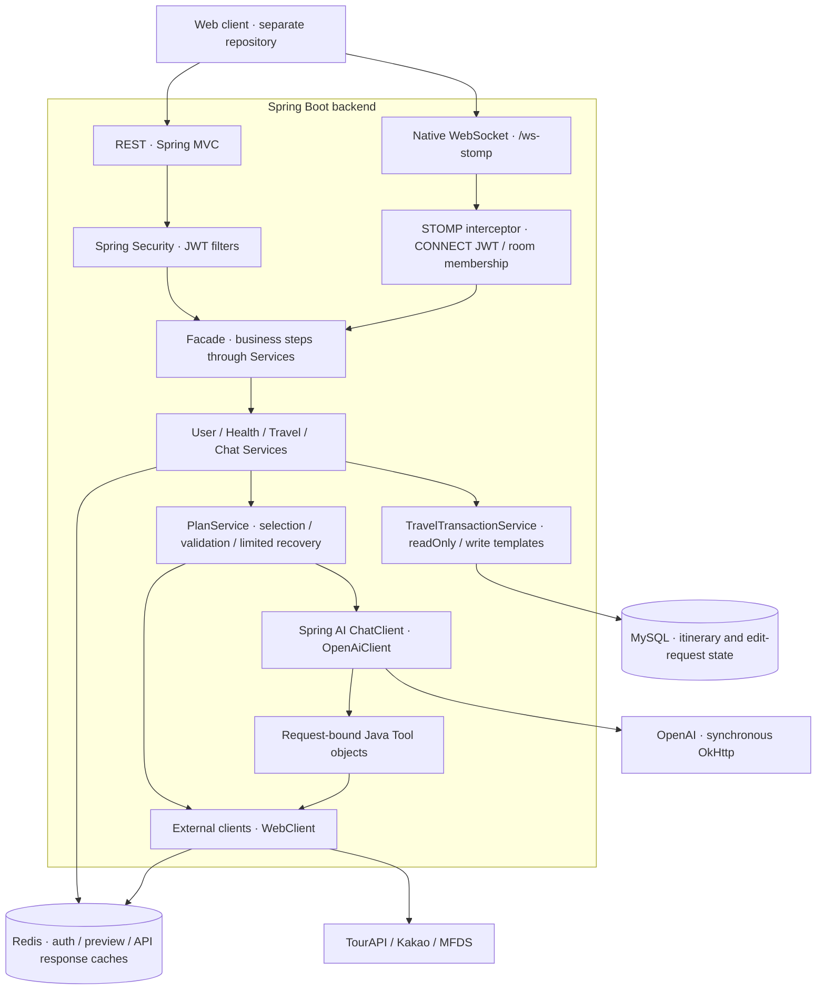
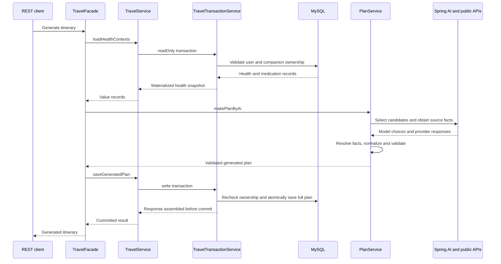
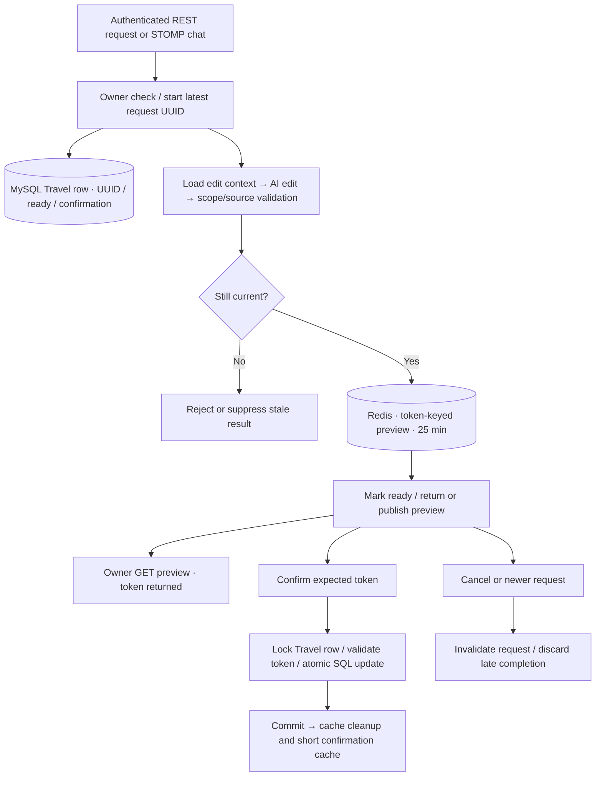
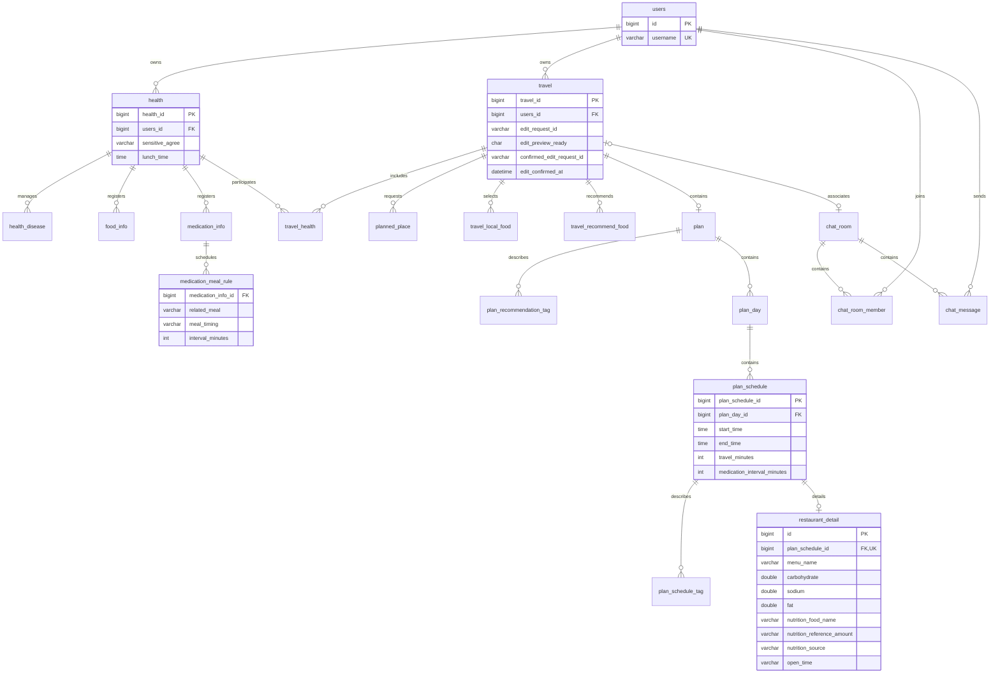
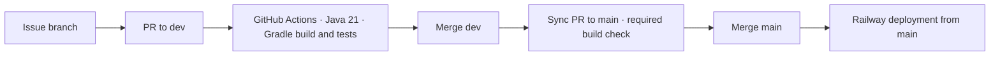

# Yeoro — Health-aware Travel Planning

A Spring Boot backend for travel itineraries that consider registered meal times,
medication reminders, dietary preferences and travel conditions. OpenAI selects
from external place and menu candidates; Java resolves source facts, checks
contracts, repairs eligible failures and controls persistence.

This is a planning aid. Nutrition database values, allergy keyword checks and
restaurant opening-hour text are not clinical advice or guarantees of ingredient
safety, actual serving size or whether a venue is open at a particular time.

> Architecture and dependency review: 2026-10-18, main code `81ccc61` (PR #221).
> The React frontend is maintained in a separate repository.

## Features

- JWT authentication, refresh token rotation and Redis-backed authentication cache
- Companion profiles with multiple conditions, meal settings and medication rules
- Travel generation using region, dates, transportation and requested places
- Candidate ID and source-menu validation, route recalculation, required meal slots
  and registered medication reminders
- Natural-language edits through REST or STOMP, with preview, confirm and cancel
- Request-scoped edit tokens, stale-result rejection and authenticated preview lookup
- Saved itinerary listing and public share links
- Source nutrition values and reference amounts, with unavailable/unevaluable states

## System Architecture

A single Spring MVC application, with blocking orchestration and JPA/JDBC
persistence. Outbound public APIs use `WebClient`; Spring AI's OpenAI integration
uses its own synchronous OkHttp path. Including WebFlux does not make the entire
request nonblocking.



The main AI path passes local Java Tool objects to `ChatClient.tools(...)`.
MCP server/client dependencies are present, but `McpToolConfig` currently exports
an empty tool-object list. The generation flow does **not** require a separate
remote MCP server hop. The `ai/mcp` package name alone is not a deployment boundary.

### Responsibility Boundaries

| Component | Responsibility |
|---|---|
| Facade | Business sequence and calls to domain/query Services |
| `PlanService` and helpers | Candidate selection, menu/source checks, scope preservation, time normalization and bounded recovery |
| `TravelTransactionService` | Short readOnly/write boundaries through `TransactionTemplate` |
| `OpenAiClient` | Model interaction, structured conversion, correction/retry and request call-budget enforcement |
| `PlaceCandidateContext` | Candidate identities, original menus and verified restaurant opening-hour evidence within a request |
| MySQL | Users, health profiles, itineraries, chat and authoritative edit-request state |
| Redis | Authentication, token-keyed previews and nutrition/TourAPI response caches |

### Generation and Transaction Boundaries



No database transaction spans the AI/network wait in this generation path.
Travel, plan, days, schedules and restaurant details are written in one final
transaction; a partial itinerary is not committed on failure. Health input uses
the start-of-request snapshot. Entity/LAZY access stays inside the relevant
transaction. Ordinary short CRUD operations can still use `@Transactional`.

### Edit Preview Lifecycle



Preview generation can update request metadata, but it does not replace the saved
itinerary until confirmation. SQL rollback keeps the preview available; cache
cleanup follows commit. Request invalidation is not a guarantee that an in-flight
provider call is interrupted. SQL and Redis do not form a distributed transaction.
Frontend reconnect/recovery behavior must be implemented by the client.

### Tools and Source Contracts

| Tool family | Purpose |
|---|---|
| `searchAttractionsByRegion`, `searchRestaurantsByLocation` | Candidate discovery |
| `getRestaurantDetail` | Provider menu text, opening-hour text and rest-day text for a matching TourAPI restaurant |
| `findPlaceWithRoute`, `getRoute` | Place resolution and transportation-specific route duration |
| `evaluateFoodNutrition` | Nutrition lookup and evaluation with explicit `UNAVAILABLE` / `NOT_EVALUABLE` outcomes |

Tool outputs inform model selection, but Java still checks identity, place type,
menu ownership and required fields. Invalid results can be rejected or locally
reselected; no claim that a prompt prevents all hallucinations.

Newly resolved restaurants use verified TourAPI opening-hour text, or null when
there is no acceptable evidence. Existing saved schedule fallback remains intact.
Rest-day text is preserved in provider DTO/cache data, not added as a new public
schedule field. Opening text is not an open-at-visit-time decision. Nutrition
reference amounts are database bases, not assumed restaurant portions.

### Database Schema

Relationship overview with selected columns, based on Flyway **V1–V20**.
Edit-request state belongs to `travel`; there is no separate SQL preview-body table.
The migration files remain the authoritative complete schema.



## Refactoring Results

### Part 1 — Resource Efficiency and Concurrent Requests

| Change | Local evidence | Adopted scope |
|---|---|---|
| Separate snapshot, AI wait and final write | At 3 req/s, p95 31.486 → 6.13 s; Hikari pending maximum 47 → 0 | Transaction boundaries in main |
| Virtual threads for blocking request waits | Independent 36 req/s comparison: p95 10.05 → 6.12 s | Environment-controlled; YAML default is false, Railway activation recorded separately |
| Bounded nutrition lookup concurrency | With two 4 s nutrition stubs, enrichment about 8 → 4 s | Code available; production default concurrency 1 |
| Repeatable observation and verification | k6 + Prometheus + Grafana, CI and regression gates | Local observation stack and GitHub Actions |

These are local controlled-stub results, not live OpenAI latency or production
capacity guarantees. Virtual threads keep blocking code; they reduce platform
thread occupancy while waiting, not the provider's response time. Database pool
and external limits remain. [Part 1 report](docs/perf/refactoring-part1-report.md).

### Part 2 — Source Fidelity, Editing and Failure Contracts

- Java candidate identity/source restoration and requested-place checks
- Original menu parsing and structured correction guidance
- Fix for prefetched restaurant candidates being cleared at AI-call entry
- Target-only editing, preview/cancel protection and stale-request handling
- Registered medication intervals, approved allergy keyword checks and route-error classification
- Provider opening-hour preservation instead of accepting AI-invented opening text
- Nutrition source/reference fields, response caches and failure observability

The menu-only follow-up observed 3/3 applied edits and 39/39 untouched slots
preserved. Another REST batch preserved 60/60 untouched slots across four edits.
These are scoped samples, not a general quality percentage. The latest adopted
opening-hour patch passed **1,132** default tests, with a subsequent **57** focused
tests after test-only refinements; these runs are not additive.

Java workflow and LangGraph4j comparisons remain **local, unadopted experiments**.
Typed stage results, request state and recovery observability were verified, but
limited live menu-only samples did not establish a quality advantage. No graph
engine dependency or workflow replacement is included in this main code.
[Part 2 report](docs/ai/refactoring-part2-report.md).

Some report/experiment documents remain local and untracked pending separate
publication; a fresh clone may not contain every linked evidence document.

## Technical Specification

Versions below are repository declarations or configured reference environments,
not a claim about every managed service's current runtime version.

| Area | Implementation / version | Scope |
|---|---|---|
| Language / build | Java 21 toolchain, Gradle wrapper 9.2.1 | Docker build/runtime use Temurin 21 JDK/JRE |
| Framework | Spring Boot 4.0.2 | Spring MVC / embedded servlet runtime |
| HTTP clients | WebFlux `WebClient`, Spring AI OpenAI synchronous OkHttp integration | Outbound API and model paths are distinct |
| AI | Spring AI BOM 2.0.0, OpenAI model from `OPENAI_MODEL` | Local Java tool callbacks; MCP starters also declared |
| Security | Spring Security, JJWT 0.12.3 | REST filters and STOMP interceptors |
| Persistence | JPA/Hibernate, MySQL Connector/J, QueryDSL Jakarta 5.0.0 | Blocking JDBC; MySQL 8.4 reference test setup |
| Schema | Flyway core + MySQL support, V1–V20 | `ddl-auto: validate` in local/prod/test/loadtest, `none` in legacy dev; OSIV disabled |
| Cache | Spring Data Redis, Redis 7.2 reference setup | Authentication, previews, provider responses |
| API docs | SpringDoc WebMVC UI 3.0.3 | OpenAPI and Swagger UI |
| Tests | JUnit Platform, Mockito, Reactor Test, Testcontainers | Default tests exclude `external` |
| Testcontainers declarations | Core/JUnit integration 1.21.3; MySQL module 2.0.5 | Actual resolution may differ through dependency management |
| Application metrics | Actuator, Micrometer, Prometheus registry | Separate management port |
| Local load observation | k6, Prometheus 3.15.0, Grafana 12.4.12 | Compose/runner images pinned by digest |
| CI / deployment | GitHub Actions build, Railway main deployment | Backend repository only |

Managed library versions without an explicit pin are resolved by the Spring Boot /
Spring AI BOMs. Check `./gradlew dependencies` for the effective graph. React client
implementation and frontend dependency versions are outside this backend review.

## Project Structure

```text
BE/
├── .github/workflows/           # CI for dev/main PRs and pushes
├── docs/
│   ├── ai/                     # Source/selection/edit contracts and Part 2 reports
│   ├── perf/                   # Load experiments and Part 1 reports
│   └── convention/             # Backend and collaboration rules
├── src/main/java/com/planb/
│   ├── ai/                     # Client, prompts, handlers, contexts, Java tools
│   ├── domain/                 # user / health / travel / chat
│   ├── query/                  # Query services and QueryDSL read layer
│   └── global/                 # External clients, security, WebSocket, config
├── src/main/resources/
│   ├── db/migration/           # Flyway V1–V20
│   ├── application.yml
│   └── application-common-*.yml
├── src/main/generated/         # Generated QueryDSL Q classes
├── src/test/java/com/planb/     # Unit / controller / slice / integration
├── src/test/k6/                # Load scenarios
├── src/test/observability/     # Compose, Prometheus, Grafana and runner
├── Dockerfile
└── build.gradle
```

The original Java package / Gradle module names remain `com.planb` / `plan_b`.

## Getting Started

### Requirements

Java 21, Git, MySQL and Redis. Docker Desktop/Engine is also needed for the
Testcontainers tests and container-based load-observation stack.

```bash
git clone https://github.com/team-planb-dev/BE.git
cd BE
```

### Environment

Supply variables through the shell or IntelliJ run configuration. A `.env` file
is **not automatically loaded** by this Gradle/Spring configuration; keep secrets
out of Git and configure explicit loading in your local tooling if using one.

| Variables | Purpose |
|---|---|
| `DATABASE_URL`, `DATABASE_USERNAME`, `DATABASE_PASSWORD` | JDBC MySQL URL and credentials |
| `REDIS_URL` | Redis URL; local defaults to `redis://localhost:6379`, production requires a value |
| `JWT_SECRET` | JWT signing secret |
| `OPENAI_API_KEY`, `OPENAI_MODEL` | Model authentication and selected model |
| `OPENAI_REASONING_EFFORT` | Optional, default `none` |
| `KOR2_SERVICE_URL`, `KOR2_SERVICE_KEY` | TourAPI URL and key |
| `KAKAO_MAP_API_BASE_URL`, `KAKAO_MOBILITY_API_BASE_URL`, `KAKAO_REST_API_KEY` | Kakao URLs and authentication |
| `FOOD_NTR_CPNT_URL`, `FOOD_NTR_CPNT_KEY` | MFDS nutrition URL and key |
| `SPRING_PROFILES_ACTIVE` | `local` default; `dev`, `prod`, `test`, `loadtest` groups available |
| `PORT`, `MANAGEMENT_PORT` | Application 8080 / management 8081 defaults |
| `SPRING_THREADS_VIRTUAL_ENABLED` | Default false; explicitly enable virtual threads per environment |
| `NUTRITION_LOOKUP_CONCURRENCY` | Production profile default 1; higher values require deliberate provider-load decisions |
| `EXTERNAL_HTTP_CONNECT_TIMEOUT`, `EXTERNAL_HTTP_READ_TIMEOUT` | Boot-managed client defaults 5 s / 15 s; provider paths may have additional timeouts |

Create the database and user first; Flyway then applies schema migrations on
startup. The legacy `dev` profile instead reads `db.url`, `db.username` and
`db.password`, and sets `ddl-auto: none`; it does not share the full local/prod
environment table above. Use `local` for the setup shown here. The test profile is normally
configured by test infrastructure, not a shortcut for running the application.

### Build and Run

```bash
./gradlew clean build
./gradlew bootRun
```

Or run the built application:

```bash
java -jar build/libs/plan_b-0.0.1-SNAPSHOT.jar
```

Swagger UI: <http://localhost:8080/swagger-ui.html><br>
OpenAPI: <http://localhost:8080/v3/api-docs>

## API and Authentication

| Route | Purpose |
|---|---|
| `POST /login` | Authentication filter login |
| `/api/v1/user`, `/api/v1/refresh/reissue` | User account and token lifecycle |
| `/api/v1/health` | Companion health profiles |
| `/api/v1/travel/add-with-recommend` | AI itinerary generation |
| `/api/v1/travel/list`, `/get-ai-travel-plan`, `/save` | Travel routes under the same `/api/v1/travel` prefix |
| `/api/v1/travel/share/issue`, `/shared/{shareToken}` | Share creation and public view under the same travel prefix |
| `POST /api/v1/travel/edit-plan/preview` | Create an edit preview |
| `GET /api/v1/travel/edit-plan/preview?travelId=...` | Owner lookup of the current preview |
| `POST /api/v1/travel/edit-plan/confirm`, `/cancel` | Confirm/cancel under the edit-plan prefix |
| `/api/v1/chat/room`, `/api/v1/chat/member` | Room and membership management |

Native WebSocket endpoint: `/ws-stomp`. Send the JWT in the STOMP `CONNECT`
`Authorization` header. Publish to `/pub/api/v1/chat/{roomId}/send` and subscribe to
`/sub/api/v1/chat/{roomId}`. Room membership is checked for SEND and SUBSCRIBE;
the HTTP handshake being permitted does not authorize chat access.

REST endpoints require JWT except the configured login/sign-up/refresh/recovery,
public sharing and API-documentation routes. See
[`SecurityConfig`](src/main/java/com/planb/global/config/security/SecurityConfig.java)
and OpenAPI DTOs for the exact contract, including optional edit tokens.

## Tests

```bash
./gradlew test
```

Default tests exclude `@Tag("external")`. Unit/controller tests mock collaborators;
slice/integration tests use Testcontainers and need a working Docker daemon.
API keys are not needed for the default test suite.

Live provider tests are a separate, metered operation:

```bash
./gradlew externalTest --tests 'com.planb.integration.domain.travel.TravelLlmQualityBaselineTest'
```

They need the relevant environment and access to OpenAI/TourAPI/Kakao/MFDS.
Use the declared evaluation protocol and record cache conditions, failures and
sample denominators. Do not substitute local stub latency for actual model quality.

## Metrics and Local Grafana

Actuator and Micrometer are enabled. The management server uses port 8081 by
default, exposing only `health`, `metrics` and `prometheus`. It is separate from
the public application port. Management requests still require authentication;
port separation is not an operator-role policy. Keep the management port out of
public routing. `health` is not configured as an anonymous public deployment probe.

Metrics include JVM/HTTP/Hikari plus AI orchestration, stages, retries, nutrition
and provider outcomes. Parent and child stage timers overlap; do not add all
stage durations together. Application series are scoped by time range, while k6
series carry `testid`.

The **local** stack is in [`src/test/observability/`](src/test/observability/):
Prometheus scrapes the app using a temporary JWT file, k6 sends remote-write
series, and Grafana uses provisioned dashboards. Ports 9090/3000 bind to
`127.0.0.1`; Prometheus retention is 2 days. This is not an installed production
monitoring service.

Start MySQL, Redis, the application with the `loadtest` profile and the stub server
in separate processes. Keep the stub task running while exercising the app:

```bash
OPENAI_STUB_DELAY_MS=3000 ./gradlew travelLoadTestStubs
```

Then, in another terminal after the application is ready:

```bash
TESTID="local-$(date +%Y%m%d-%H%M%S)" \
SCENARIO=plan-throughput \
PLAN_RATE=1 \
PLAN_DURATION=60s \
src/test/observability/run-observed-load.sh
```

The runner creates the scraper token, starts Compose and prints the exact Grafana
time-range link. Dashboard: <http://localhost:3000/d/travel-load>;
Prometheus targets: <http://localhost:9090/targets>. Export measurement data and
screenshots before retention expires; the dashboard definition JSON alone is not
measurement evidence. The runner deletes the JWT on exit, after which a DOWN
scrape target is expected. Stop Compose using the command printed by the runner.
Detailed profile/setup instructions: [observation guide](docs/perf/phase4a-observability.md).

Spring AI logging is INFO in the current configuration; external clients retain
DEBUG configuration. No claim of centralized production log collection.

## CI and Deployment



[CI](.github/workflows/ci.yml) runs `./gradlew build` for dev/main PRs and pushes.
The default test task excludes metered external tests. Failed jobs upload test
reports; the build check gates protected-branch merges. Railway deploys main
independently of the GitHub Actions job, rather than from a deploy step in CI.

The Dockerfile builds `bootJar` with a Java 21 JDK and runs it on a Java 21 JRE.
Docker image build skips tests; the PR CI gate is the verification path. `PORT`
controls the application listener. Production database migrations run at startup.
Main merges change the deployment environment; publish only explicitly adopted
scope, with a separate sync PR and deployment review.

## Documentation and Contribution

- [AI contracts and evidence index](docs/ai/README.md)
- [Backend convention](docs/convention/backend-convention.md)
- [Part 1 report](docs/perf/refactoring-part1-report.md)
- [Part 2 report](docs/ai/refactoring-part2-report.md)

Use the repository Issue/PR/sync templates, English `type : summary` commit titles,
`#issue-number type : summary` PR/merge titles, and `Refs #N` on dev-target PRs.
Assign the owner, labels, Issue type, Priority and Effort. Close an issue explicitly
when its accepted scope is merged into dev; do not rely on a dev PR to auto-close it.

## Team

| Role | Name | GitHub |
|------|------|--------|
|PM|이승협|.|
|Designer|조예원|.|
| Backend | 강우주 | <a href="https://github.com/wooju-kang"></a> |
| Frontend | 임성은 | <a href="https://github.com/sungeunlim03"></a> |
