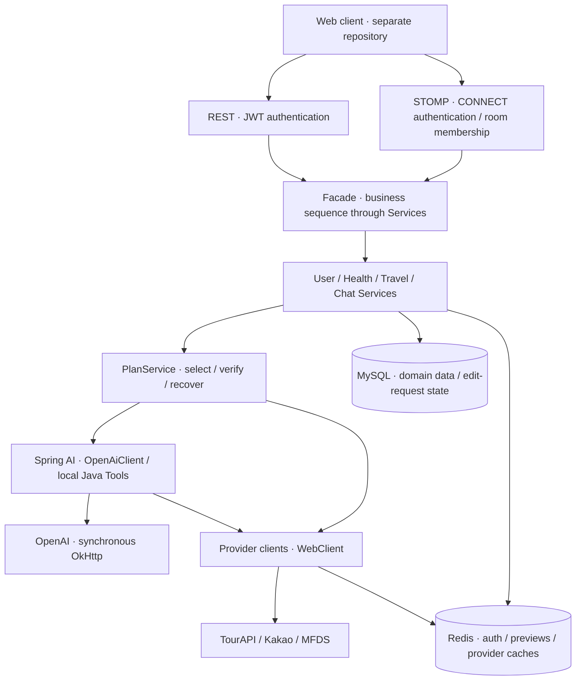
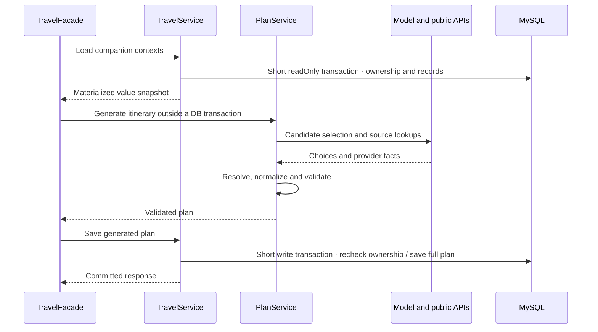
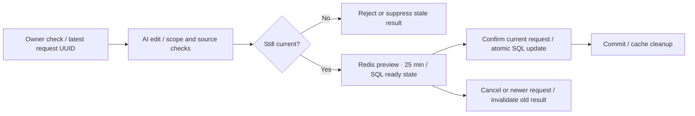
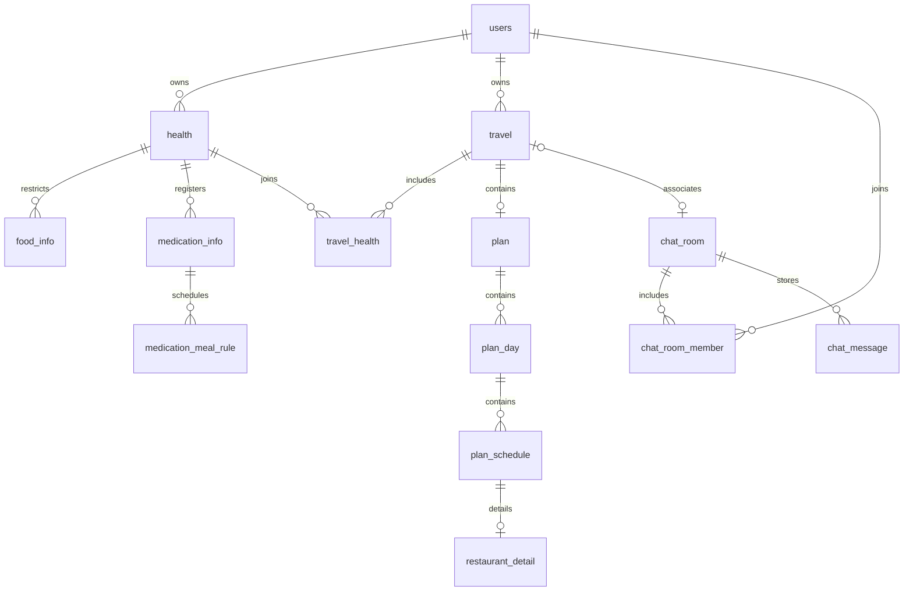

# Yeoro — Health-aware Travel Planning

A Spring Boot backend for domestic travel plans that combine companion profiles,
registered meal and medication schedules, and travel preferences.
**AI selects; Java verifies source facts, protects edit scope and controls storage.**

| Project | Details |
|---|---|
| Development | 2026-07-28 – 2026-10-17 |
| Competition | 2026 관광데이터 활용 공모전(웹·앱 구현 부문) |
| Backend | Java 21 · Spring Boot 4.0.2 · Spring AI 2.0.0 · MySQL · Redis |
| Frontend | React, maintained in a separate repository |

[Features](#features) · [Architecture](#architecture) · [Refactoring](#refactoring) ·
[Getting started](#getting-started) · [API](#api-and-authentication) · [Tests](#tests-and-observation)

## Features

- **Companion profiles:** health consent, dietary restrictions, meal times and medication rules
- **Itinerary generation:** region, dates, transportation, requested places and selected companions
- **Source checks:** candidate identity, place type, original menu, route duration and required slots
- **Partial editing:** natural-language requests over REST or STOMP, with before/after previews
- **Explicit confirmation:** confirm, cancel and discard stale edit results without replacing the original early
- **Saved plans and sharing:** itinerary lists and token-based public views

Nutrition values and opening-hour text are reference data. They do not establish
ingredient safety, actual serving size, clinical suitability or whether a venue
will be open at the planned visit time. Medication slots reflect registered rules;
they are not push notifications or medical instructions.

## Architecture

One Spring MVC application with JPA/JDBC persistence. External public APIs use
`WebClient`; the Spring AI OpenAI integration uses a synchronous OkHttp path.
The application retains blocking orchestration rather than a full WebFlux rewrite.



### Responsibility boundaries

| Owner | Responsibility |
|---|---|
| Facade | Business order through domain/query Services |
| `PlanService` and helpers | Candidate/menu checks, edit-scope preservation, time normalization and bounded recovery |
| `OpenAiClient` | Structured model output, correction/retry and request call budgets |
| `PlaceCandidateContext` | Request-local candidate identities, original menus and opening-hour evidence |
| `TravelTransactionService` | Short readOnly/write transactions through `TransactionTemplate` |
| MySQL / Redis | Authoritative domain/request state / temporary results and reusable provider responses |

Tools are local Java objects passed to `ChatClient.tools(...)`. MCP dependencies
and package names do not imply a remote MCP server hop; `McpToolConfig` currently
exports an empty tool-object list. Graph/workflow adapters are local experiments,
not part of this main branch.

### Generation: snapshot → AI and verification → atomic write



The database connection is not held throughout the AI/network wait. Travel,
plan, days, schedules and restaurant details commit together; a failed final
write does not leave a partial itinerary. Health settings use the request-start
snapshot, with entity/LAZY access inside the relevant transaction.

Generation already persists the itinerary. The later `saved` flag marks the
user's save decision; it is distinct from database persistence and edit previews.
[Transaction implementation](src/main/java/com/planb/domain/travel/service/TravelTransactionService.java).

<details>
<summary><strong>Edit previews and data relationships</strong></summary>



SQL owns the request UUID, readiness and confirmation state; Redis owns the
preview body. Confirmation locks the Travel row and validates a supplied token;
omitting it targets the current request.
SQL rollback preserves the preview; cleanup follows commit. Invalidation does
not guarantee interruption of an in-flight provider call, and SQL/Redis are not
a distributed transaction. Owner-authenticated GET supports preview recovery;
reconnection UI remains the client's responsibility.



Conceptual relationships, not the complete SQL schema. Companion profiles are
owned by an account; they are not independent login accounts or chat members.
[Flyway V1–V20](src/main/resources/db/migration/) is the schema source of truth.

</details>

## Refactoring

### Part 1 — Resource efficiency

| Change | Local observation | Adopted scope |
|---|---|---|
| Short generation transactions | 3 req/s: p95 **31.486 → 6.13 s**, Hikari pending maximum **47 → 0** | Snapshot / AI / final-write separation |
| Virtual threads | Independent 36 req/s comparison: p95 **10.05 → 6.12 s** | Environment toggle; YAML default false |
| Bounded nutrition lookups | Two 4 s nutrition stubs: enrichment about **8 → 4 s** | Code available; production concurrency default 1 |

Controlled-stub results, not production capacity or live OpenAI latency.
Virtual threads reduce platform-thread occupancy during supported blocking waits;
DB pool size and provider limits remain. Railway activation is recorded separately
from the default YAML setting.

Evidence: [transaction result](docs/perf/phase5a-transaction-result.md) ·
[36 req/s comparison](docs/perf/phase5b-main-comparison.md) ·
[nutrition experiment](docs/perf/phase5c-nutrition-grafana-result.md).

### Part 2 — Source fidelity and editing contracts

- Restore place facts from candidate IDs; validate menu ownership and requested places
- Preserve prefetched restaurant candidates at AI-call entry
- Limit edits to requested targets and protect original/stale results
- Separate route-provider failures from invalid AI selections
- Preserve verified opening-hour text and nutrition source/reference fields

A menu-only batch observed **3/3 applied edits and 39/39 untouched slots preserved**;
a separate four-edit REST batch preserved **60/60 untouched slots**. These are
scoped observations, not an overall quality score. The adopted opening-hour patch
passed 1,132 default tests; a subsequent 57-test focused run is not additive.

Java workflow and LangGraph4j experiments verified explicit state and recovery
contracts but did not establish a quality advantage in limited live samples.
**Production adoption remains deferred.** Nutrition completeness, actual portions,
ingredients and open-at-visit-time checks also remain limited.

Evidence: [editing contracts](docs/ai/p2-6a-edit-scope-result.md) ·
[opening-hour source context](src/main/java/com/planb/ai/context/PlaceCandidateContext.java) ·
[AI documentation index](docs/ai/README.md).

## Getting started

Java 21, Git, a provisioned MySQL database/user and Redis are required.
Docker is needed for Testcontainers and the local observation stack.

```bash
git clone https://github.com/team-planb-dev/BE.git
cd BE
```

Provide environment variables through the shell or IntelliJ run configuration.
**This configuration does not automatically load `.env`.** Keep credentials out of Git.

<details>
<summary><strong>Environment variables and declared versions</strong></summary>

| Variables | Purpose |
|---|---|
| `DATABASE_URL`, `DATABASE_USERNAME`, `DATABASE_PASSWORD` | JDBC MySQL URL and credentials |
| `REDIS_URL` | Local default `redis://localhost:6379`; required in production |
| `JWT_SECRET` | JWT signing secret |
| `OPENAI_API_KEY`, `OPENAI_MODEL` | Model credentials and selection |
| `OPENAI_REASONING_EFFORT` | Optional; default `none` |
| `KOR2_SERVICE_URL`, `KOR2_SERVICE_KEY` | TourAPI base URL and key |
| `KAKAO_MAP_API_BASE_URL`, `KAKAO_MOBILITY_API_BASE_URL`, `KAKAO_REST_API_KEY` | Kakao base URLs and key |
| `FOOD_NTR_CPNT_URL`, `FOOD_NTR_CPNT_KEY` | MFDS base URL and key |
| `SPRING_PROFILES_ACTIVE` | Default `local`; profile groups in `application.yml` |
| `PORT`, `MANAGEMENT_PORT` | Defaults 8080 / 8081 |
| `SPRING_THREADS_VIRTUAL_ENABLED` | Default false; enable explicitly per environment |
| `NUTRITION_LOOKUP_CONCURRENCY` | Production profile default 1 |
| `EXTERNAL_HTTP_CONNECT_TIMEOUT`, `EXTERNAL_HTTP_READ_TIMEOUT` | Boot client defaults 5 s / 15 s; individual paths may add timeouts |

Use `local` for these instructions. Legacy `dev` reads `db.url`, `db.username`
and `db.password` instead. The test profile is configured by test infrastructure.
Flyway applies migrations at startup; `ddl-auto` is `validate` for local/prod/test/loadtest
and `none` for legacy dev. OSIV is disabled.

| Area | Repository declaration |
|---|---|
| Language / build | Java 21 · Gradle wrapper 9.2.1 |
| Framework / AI | Spring Boot 4.0.2 · Spring AI BOM 2.0.0 |
| HTTP / messaging | MVC · outbound WebClient · OpenAI synchronous OkHttp · native STOMP |
| Security | Spring Security · JJWT 0.12.3 |
| Persistence | JPA/Hibernate · MySQL Connector/J · QueryDSL Jakarta 5.0.0 · Flyway |
| Cache | Spring Data Redis; MySQL 8.4 / Redis 7.2 reference test environments |
| API documentation | SpringDoc WebMVC UI 3.0.3 |
| Test declarations | JUnit Platform · Mockito · Reactor Test · Testcontainers core/JUnit 1.21.3, MySQL module 2.0.5 |
| Observation | Actuator · Micrometer · k6 · Prometheus 3.15.0 · Grafana 12.4.12 |

Declarations/reference environments are not managed-service runtime guarantees.
BOM-managed effective versions are available through `./gradlew dependencies`.
See [build.gradle](build.gradle) and [profile configuration](src/main/resources/).

</details>

With the variables configured and MySQL/Redis running:

```bash
./gradlew bootRun
```

Swagger UI: <http://localhost:8080/swagger-ui.html> · OpenAPI: <http://localhost:8080/v3/api-docs>.
Build with `./gradlew clean build` when Docker is available, then run
`java -jar build/libs/plan_b-0.0.1-SNAPSHOT.jar`. The original package/module names
remain `com.planb` / `plan_b`.

## API and authentication

| Entry point | Purpose |
|---|---|
| `POST /login`, `/api/v1/refresh/reissue` | Login and token lifecycle |
| `/api/v1/user`, `/api/v1/health` | Accounts and companion profiles |
| `/api/v1/travel/add-with-recommend` | Generate an itinerary |
| `/api/v1/travel/list`, `/get-ai-travel-plan`, `/save` | List/read/save under the travel prefix |
| `/api/v1/travel/share/issue`, `/shared/{shareToken}` | Issue/read shares under the travel prefix |
| `/api/v1/travel/edit-plan/preview`, `/confirm`, `/cancel` | Preview/confirm/cancel under the edit-plan prefix |
| `/api/v1/chat/room`, `/api/v1/chat/member` | Rooms and membership |

Use [OpenAPI controllers](src/main/java/com/planb/domain/) and
[SecurityConfig](src/main/java/com/planb/global/config/security/SecurityConfig.java)
for exact methods, DTOs and public-route exceptions. REST normally requires JWT.

Native WebSocket: `/ws-stomp`; authenticate in the STOMP `CONNECT` `Authorization`
header, send to `/pub/api/v1/chat/{roomId}/send`, subscribe to
`/sub/api/v1/chat/{roomId}`. SEND/SUBSCRIBE check room membership; editing also
requires travel ownership. An allowed HTTP handshake does not authorize messages.

## Tests and observation

```bash
./gradlew test
```

Default tests exclude `@Tag("external")` and require no provider keys.
Slice/integration tests need Docker. Live provider tests are a separate metered operation:

```bash
./gradlew externalTest --tests 'com.planb.integration.domain.travel.TravelLlmQualityBaselineTest'
```

Record scenarios, sample denominators, cache conditions and failures. Local
stub latency does not measure live AI quality.

<details>
<summary><strong>Local k6 / Prometheus / Grafana</strong></summary>

The [observation guide](docs/perf/phase4a-observability.md) covers MySQL/Redis,
the `loadtest` app and a separate stub process. Keep the stub running:

```bash
OPENAI_STUB_DELAY_MS=3000 ./gradlew travelLoadTestStubs
```

Once the app is ready, run in another terminal:

```bash
TESTID="local-$(date +%Y%m%d-%H%M%S)" \
SCENARIO=plan-throughput \
PLAN_RATE=1 \
PLAN_DURATION=60s \
src/test/observability/run-observed-load.sh
```

The runner starts Compose and prints the measured Grafana time-range URL.
Grafana: <http://localhost:3000/d/travel-load> · Prometheus: <http://localhost:9090/targets>.
Both bind to loopback. Retention is 2 days; export values and screenshots before expiry.
The runner removes its temporary scrape JWT on exit, so a later DOWN target is expected.
Stop Compose with the command printed by the runner.

This is a local stack, not production monitoring. Management defaults to port
8081 with authenticated `health`, `metrics`, `prometheus`; keep it out of public
routing. Port separation is not operator-role authorization, and `health` is not
an anonymous deployment probe. Stage timers overlap and must not be summed.
Application metrics use time ranges; k6 series carry `testid`.

</details>

## CI, deployment and contribution

[GitHub Actions](.github/workflows/ci.yml) runs `./gradlew build` on dev/main PRs
and pushes, including README-only changes. External tests are excluded.
Railway deploys main separately from CI; the server being stopped does not change
these repository triggers. Docker builds the Java 21 JAR without tests; CI is the build/test gate.

Normal changes follow Issue → branch → dev PR → main sync PR. Read the
[repository templates](.github/ISSUE_TEMPLATE/) and
[team convention](docs/convention/team-convention.md).
Use `type : summary` commits, `#issue-number type : summary` PR/merge titles,
owner/labels/type/Priority/Effort, and `Refs #N` for dev PRs. Close an issue explicitly
when its accepted scope is merged into dev; a dev PR does not auto-close it.
Main publication and server deployment require a separate decision.

## Documentation and team

- [AI contracts and evidence index](docs/ai/README.md)
- [Performance experiments](docs/perf/)
- [Backend convention](docs/convention/backend-convention.md)

Detailed portfolio reports are maintained locally and are not all part of a fresh clone.
Architecture review: 2026-10-27, main code `81ccc61`; no graph engine in this main-code baseline.

| Role | Name | GitHub |
|---|---|---|
| PM | 이승협 | — |
| Designer | 조예원 | — |
| Backend | 강우주 | [KangWooJu](https://github.com/KangWooJu) |
| Frontend | 임성은 | [sungeunlim03](https://github.com/sungeunlim03) |
